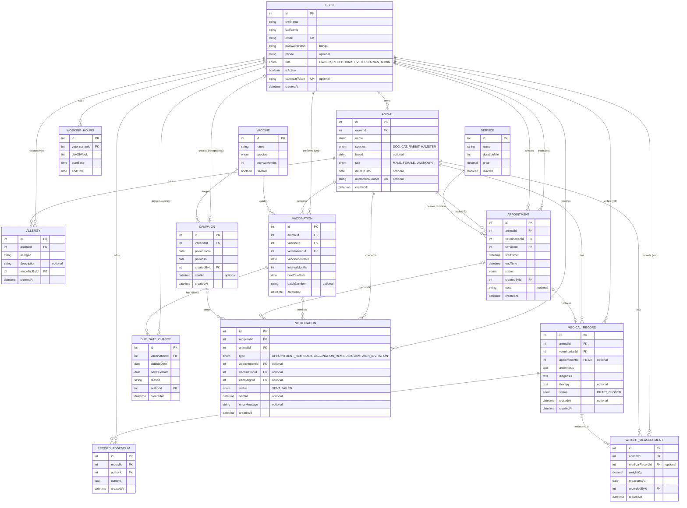

# Podatkovni model

Petalog uporablja relacijsko podatkovno bazo **PostgreSQL**, do katere backend dostopa prek ORM **Prisma**. Shema je zapisana v datoteki `backend/prisma/schema.prisma`, tabele pa se ustvarijo z migracijami.

**Poimenovanje:** imena entitet, polj in enumov so v angleščini, ker se neposredno uporabljajo v kodi (brez šumnikov in mešanja jezikov). Opisi so v slovenščini. Entitete so zapisane v `PascalCase`, polja pa v `camelCase`.

## Slovar izrazov

| Entiteta (koda) | Pomen |
|---|---|
| `User` | uporabnik (lastnik, receptor, veterinar, administrator) |
| `Animal` | žival, pacient ambulante |
| `Allergy` | alergija živali |
| `MedicalRecord` | zdravstveni zapis (obravnava) |
| `RecordAddendum` | dodatek k zaključenemu zdravstvenemu zapisu |
| `WeightMeasurement` | meritev teže |
| `Vaccine` | cepivo (šifrant s pravilom ponovnega cepljenja) |
| `Vaccination` | opravljeno cepljenje |
| `DueDateChange` | sprememba roka cepljenja |
| `Service` | storitev ambulante |
| `Appointment` | termin |
| `WorkingHours` | delovni čas veterinarja |
| `Campaign` | kampanja za cepljenje |
| `Notification` | poslano e-poštno obvestilo (opomnik ali vabilo) |

## Entitete in glavna polja

### User
Vsi uporabniki sistema, ne glede na vlogo.

| Polje | Tip | Opis |
|---|---|---|
| id | int, PK | |
| firstName | string | ime |
| lastName | string | priimek |
| email | string, unikatno | uporablja se za prijavo in pošiljanje obvestil |
| passwordHash | string | geslo, zgoščeno z bcrypt |
| phone | string, neobvezno | |
| role | enum | `OWNER`, `RECEPTIONIST`, `VETERINARIAN`, `ADMIN` |
| isActive | boolean | deaktiviran uporabnik se ne more prijaviti |
| calendarToken | string, unikatno, neobvezno | skrivni žeton v povezavi do osebnega koledarja (iCal) |
| createdAt | datetime | |

### Animal
Pacient ambulante. Pripada natanko enemu lastniku.

| Polje | Tip | Opis |
|---|---|---|
| id | int, PK | |
| ownerId | int, FK → User | uporabnik z vlogo `OWNER` |
| name | string | ime živali |
| species | enum | `DOG`, `CAT`, `RABBIT`, `HAMSTER` |
| breed | string, neobvezno | pasma |
| sex | enum | `MALE`, `FEMALE`, `UNKNOWN` |
| dateOfBirth | date, neobvezno | |
| microchipNumber | string, unikatno, neobvezno | številka čipa |
| createdAt | datetime | |

### Allergy
Alergije in preobčutljivosti živali. Pri vnosu terapije se prikažejo nad poljem za terapijo.

| Polje | Tip | Opis |
|---|---|---|
| id | int, PK | |
| animalId | int, FK → Animal | |
| allergen | string | npr. *penicilin* |
| description | string, neobvezno | reakcija, resnost |
| recordedById | int, FK → User | veterinar, ki je alergijo vnesel |
| createdAt | datetime | |

### MedicalRecord
En zapis obravnave v kartonu živali.

| Polje | Tip | Opis |
|---|---|---|
| id | int, PK | |
| animalId | int, FK → Animal | |
| veterinarianId | int, FK → User | avtor zapisa |
| appointmentId | int, FK → Appointment, unikatno, neobvezno | povezava na termin, če je zapis nastal iz obravnave termina |
| anamnesis | text | anamneza |
| diagnosis | text | diagnoza |
| therapy | text, neobvezno | terapija, vključno z odmerkom, izračunanim s kalkulatorjem |
| status | enum | `DRAFT` (osnutek), `CLOSED` (zaključen) |
| closedAt | datetime, neobvezno | čas zaključka |
| createdAt | datetime | |

### RecordAddendum
Popravek ali dopolnitev že zaključenega zapisa. Prvotni zapis ostane nespremenjen.

| Polje | Tip | Opis |
|---|---|---|
| id | int, PK | |
| recordId | int, FK → MedicalRecord | |
| authorId | int, FK → User | |
| content | text | vsebina dodatka |
| createdAt | datetime | |

### WeightMeasurement
Meritev teže živali. Iz meritev se izriše graf teže, zadnja meritev pa se uporablja v kalkulatorju odmerka.

| Polje | Tip | Opis |
|---|---|---|
| id | int, PK | |
| animalId | int, FK → Animal | |
| medicalRecordId | int, FK → MedicalRecord, neobvezno | obravnava, pri kateri je bila teža izmerjena |
| weightKg | decimal | teža v kilogramih |
| measuredAt | date | datum meritve |
| recordedById | int, FK → User | veterinar, ki je meritev vnesel |
| createdAt | datetime | |

### Vaccine *(šifrant)*
Seznam cepiv s pravilom ponovnega cepljenja. Začetni seznam se naloži s seed skripto.

| Polje | Tip | Opis |
|---|---|---|
| id | int, PK | |
| name | string | npr. *steklina* |
| species | enum | vrsta živali, za katero je cepivo namenjeno (enake vrednosti kot `Animal.species`) |
| intervalMonths | int | trenutno veljavni interval ponovnega cepljenja, npr. 12 za steklino |
| isActive | boolean | |

### Vaccination
Opravljeno cepljenje posamezne živali.

| Polje | Tip | Opis |
|---|---|---|
| id | int, PK | |
| animalId | int, FK → Animal | |
| vaccineId | int, FK → Vaccine | |
| veterinarianId | int, FK → User | |
| vaccinationDate | date | datum cepljenja |
| intervalMonths | int | interval, ki je veljal ob cepljenju (kopija iz `Vaccine`) |
| nextDueDate | date | izračuna se ob vnosu: `vaccinationDate + intervalMonths` |
| batchNumber | string, neobvezno | serijska številka cepiva |
| createdAt | datetime | |

### DueDateChange
Zgodovina sprememb roka cepljenja, kadar administrator po spremembi pravila ponovno izračuna roke obstoječih cepljenj.

| Polje | Tip | Opis |
|---|---|---|
| id | int, PK | |
| vaccinationId | int, FK → Vaccination | |
| oldDueDate | date | rok pred ponovnim izračunom |
| newDueDate | date | rok po ponovnem izračunu |
| reason | string | npr. *sprememba pravilnika o cepljenju* |
| authorId | int, FK → User | administrator, ki je sprožil ponovni izračun |
| createdAt | datetime | |

### Service
Storitev, ki jo ambulanta ponuja in na katero se lastnik naroči.

| Polje | Tip | Opis |
|---|---|---|
| id | int, PK | |
| name | string | npr. *splošni pregled* |
| durationMin | int | trajanje v minutah, določa dolžino termina |
| price | decimal | cena |
| isActive | boolean | |

### Appointment
Termin obravnave živali pri veterinarju.

| Polje | Tip | Opis |
|---|---|---|
| id | int, PK | |
| animalId | int, FK → Animal | |
| veterinarianId | int, FK → User | |
| serviceId | int, FK → Service | |
| startTime | datetime | začetek termina |
| endTime | datetime | `endTime = startTime + service.durationMin` |
| status | enum | `BOOKED`, `CONFIRMED`, `WAITING`, `IN_PROGRESS`, `COMPLETED`, `CANCELLED`, `NO_SHOW` |
| createdById | int, FK → User | lastnik ali receptor, ki je termin ustvaril |
| note | string, neobvezno | opomba |
| createdAt | datetime | |

Statusi: `BOOKED` rezerviran, `CONFIRMED` potrjen, `WAITING` v čakalnici, `IN_PROGRESS` v obravnavi, `COMPLETED` zaključen, `CANCELLED` odpovedan, `NO_SHOW` ni prišel.

### WorkingHours
Redni tedenski urnik veterinarja. En zapis predstavlja delovni blok na izbrani dan v tednu.

| Polje | Tip | Opis |
|---|---|---|
| id | int, PK | |
| veterinarianId | int, FK → User | |
| dayOfWeek | int | 1 = ponedeljek … 7 = nedelja |
| startTime | time | začetek delovnega bloka |
| endTime | time | konec delovnega bloka |

### Campaign
Kampanja za cepljenje, s katero receptor povabi lastnike živali, ki jim v izbranem obdobju zapade cepljenje.

| Polje | Tip | Opis |
|---|---|---|
| id | int, PK | |
| vaccineId | int, FK → Vaccine | cepivo, za katero se pošiljajo vabila |
| periodFrom | date | začetek obdobja zapadlosti |
| periodTo | date | konec obdobja zapadlosti |
| createdById | int, FK → User | receptor, ki je kampanjo ustvaril |
| sentAt | datetime, neobvezno | čas pošiljanja vabil |
| createdAt | datetime | |

### Notification
Evidenca vseh e-poštnih obvestil: opomnikov za termine, opomnikov za cepljenja in vabil iz kampanj. Služi kot dnevnik pošiljanja in preprečuje podvojena obvestila.

| Polje | Tip | Opis |
|---|---|---|
| id | int, PK | |
| recipientId | int, FK → User | lastnik, ki mu je obvestilo poslano |
| animalId | int, FK → Animal | žival, na katero se obvestilo nanaša |
| type | enum | `APPOINTMENT_REMINDER`, `VACCINATION_REMINDER`, `CAMPAIGN_INVITATION` |
| appointmentId | int, FK → Appointment, neobvezno | pri opomniku za termin |
| vaccinationId | int, FK → Vaccination, neobvezno | pri opomniku za cepljenje |
| campaignId | int, FK → Campaign, neobvezno | pri vabilu iz kampanje |
| status | enum | `SENT`, `FAILED` |
| sentAt | datetime, neobvezno | čas uspešnega pošiljanja |
| errorMessage | string, neobvezno | razlog neuspešnega pošiljanja |
| createdAt | datetime | |

## Povezave med entitetami

| Povezava | Kardinalnost | Opis |
|---|---|---|
| User (lastnik) → Animal | 1 : N | lastnik ima več živali, žival ima enega lastnika |
| Animal → Allergy | 1 : N | |
| Animal → MedicalRecord | 1 : N | karton živali je zbirka njenih zapisov |
| User (veterinar) → MedicalRecord | 1 : N | avtor zapisa |
| MedicalRecord → RecordAddendum | 1 : N | dodatki k zaključenemu zapisu |
| Animal → WeightMeasurement | 1 : N | zgodovina teže |
| MedicalRecord → WeightMeasurement | 1 : 0..N | teža, izmerjena pri obravnavi |
| Animal → Vaccination | 1 : N | |
| Vaccine → Vaccination | 1 : N | interval cepiva ob vnosu določa `nextDueDate` |
| Vaccination → DueDateChange | 1 : N | zgodovina ponovnih izračunov roka |
| Animal → Appointment | 1 : N | |
| Service → Appointment | 1 : N | trajanje storitve določa `endTime` termina |
| User (veterinar) → Appointment, WorkingHours | 1 : N | |
| Appointment → MedicalRecord | 1 : 0..1 | obravnava iz termina ustvari en zapis |
| Vaccine → Campaign | 1 : N | |
| User (receptor) → Campaign | 1 : N | avtor kampanje |
| User (lastnik) → Notification | 1 : N | prejemnik obvestila |
| Animal → Notification | 1 : N | |
| Appointment, Vaccination, Campaign → Notification | 1 : N | vir obvestila (glede na vrsto) |

## Osnutek podatkovnega modela

## Pravila nad podatki

- **Stanje cepljenja se ne shranjuje**, ampak se izračuna ob branju glede na današnji datum: *zapadlo*, če je `nextDueDate` v preteklosti, *kmalu zapade*, če je v naslednjih 30 dneh, sicer *veljavno*. Tako je stanje vedno pravilno brez ročnega posodabljanja.
- **Sprememba pravila cepiva ne spreminja preteklosti.** Ko administrator spremeni interval cepiva, nova vrednost velja samo za nova cepljenja, saj vsako cepljenje hrani interval, ki je veljal ob vnosu. Če nova pravila veljajo tudi za že opravljena cepljenja, administrator izrecno sproži ponovni izračun: ta zajame le še nezapadla cepljenja tega cepiva, spremeni samo `nextDueDate` (nikoli datuma, cepiva ali veterinarja) in vsako spremembo zabeleži v `DueDateChange`.
- **Zaključenega zapisa backend ne dovoli spremeniti.** Zahtevo za urejanje zapisa s statusom `CLOSED` zavrne, popravek je mogoč le kot nov `RecordAddendum`.
- **Medicinska evidenca se ne briše.** Tuji ključi na zapise, cepljenja, alergije in meritve teže imajo nastavitev `ON DELETE RESTRICT`, zato žival ali uporabnika z evidenco ni mogoče izbrisati, le deaktivirati.
- **Opozorilo na alergije:** pri vnosu terapije uporabniški vmesnik nad poljem za terapijo izpiše vse zabeležene alergije živali. Samodejnega ujemanja besedila ni, presoja ostane pri veterinarju.
- **Kalkulator odmerka** se ne shranjuje kot ločena entiteta. Skupni odmerek se izračuna kot `odmerek (mg/kg) × zadnja weightKg` in se vstavi v besedilo terapije. Če je zadnja meritev starejša od 30 dni ali je ni, vmesnik prikaže opozorilo.
- **Prekrivanje terminov:** za istega veterinarja se termini s statusom, ki ni `CANCELLED` ali `NO_SHOW`, ne smejo časovno prekrivati in morajo v celoti ležati znotraj njegovega delovnega časa (`WorkingHours`). Pravilo preverja backend znotraj transakcije, preden termin shrani.
- **Odpoved termina:** lastnik lahko termin odpove ali prestavi le, če je do `startTime` več kot 24 ur. Po tem roku to lahko stori samo receptor.
- **Brez podvojenih obvestil:** v tabeli `Notification` veljajo unikatne omejitve nad (`type`, `appointmentId`), (`type`, `vaccinationId`) in (`campaignId`, `animalId`). Pred pošiljanjem se zapis ustvari, ob neuspehu pa dobi status `FAILED` in se pri naslednjem zagonu opravila ponovno poskusi poslati, brez novega zapisa.
- **Izbor živali za kampanjo:** zajete so živali, katerih zadnje cepljenje z izbranim cepivom ima `nextDueDate` znotraj obdobja `periodFrom`–`periodTo` in ki nimajo prihodnjega termina s statusom `BOOKED` ali `CONFIRMED`.
- **Koledarska povezava:** `calendarToken` je naključen niz, ki se ustvari na zahtevo lastnika. Ob ponovni ustvaritvi se stari žeton zamenja, zato stara povezava preneha delovati. Brez žetona koledar ni dostopen.
- **Časovni pas:** vsi datumi in časi se v bazi shranjujejo v UTC, za izračune (npr. *jutri*, *čez 14 dni*, 24-urni rok odpovedi) in prikaz pa se uporablja časovni pas `Europe/Ljubljana`.
- **Začetni podatki (seed):** ob prvem zagonu se naložijo cepiva z intervali, storitve, račun administratorja ter testni računi veterinarja, receptorja in lastnika z nekaj živalmi.
