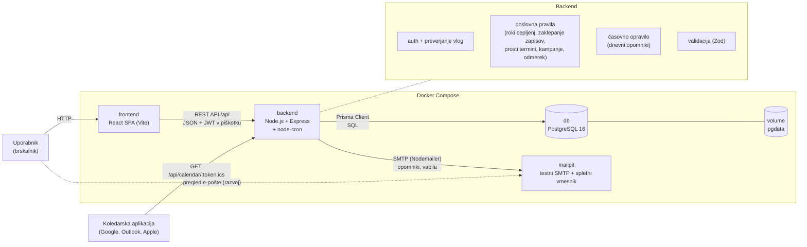

# Arhitektura in tehnološki sklad

## Arhitektura

Petalog je zasnovan kot **troslojna spletna aplikacija**: odjemalski del (frontend) teče v brskalniku, strežniški del (backend) izpostavlja REST API in vsebuje poslovna pravila, podatki pa so shranjeni v relacijski podatkovni bazi. Za pošiljanje e-pošte se med razvojem uporablja lokalni testni poštni strežnik. Vsak del teče v svojem Docker kontejnerju.

**Jezik kode:** imena modulov, endpointov, entitet in spremenljivk so v angleščini (glej slovar izrazov v `03-podatkovni-model.md`), besedila v uporabniškem vmesniku in e-poštnih sporočilih pa v slovenščini.

### Glavni deli sistema

- **Frontend** – enostranska aplikacija (SPA) v Reactu. Prikazuje uporabniški vmesnik glede na vlogo prijavljenega uporabnika (lastnik, receptor, veterinar, administrator), preverja vnose v obrazcih, izrisuje grafe (teža živali, statistika) in kliče backend prek REST API. Ne vsebuje poslovnih pravil in nima neposrednega dostopa do baze.
- **Backend** – REST API v Node.js (Express). Skrbi za avtentikacijo, preverjanje pravic po vlogah, validacijo podatkov in vsa poslovna pravila (izračun rokov cepljenj, zaklepanje zaključenih zapisov, prosti termini, pravila odpovedi, izbor živali za kampanjo, izračun odmerka, statistika). Koda je razdeljena na module po domenah:

  | Modul | Odgovornost |
  |---|---|
  | `auth` | registracija, prijava, odjava, preverjanje vlog |
  | `users` | računi osebja, profil, koledarski žeton |
  | `animals` | profili živali, zdravstvena časovnica |
  | `allergies` | alergije živali |
  | `medical-records` | zdravstveni zapisi, zaključevanje, dodatki |
  | `weights` | meritve teže, kalkulator odmerka |
  | `vaccines` | šifrant cepiv, ponovni izračun rokov |
  | `vaccinations` | cepljenja, izračun roka in stanja |
  | `services` | storitve ambulante |
  | `working-hours` | delovni čas veterinarjev |
  | `appointments` | prosti termini, rezervacija, statusni potek |
  | `notifications` | časovno opravilo, opomniki, pošiljanje e-pošte |
  | `campaigns` | kampanje za cepljenje |
  | `calendar` | generiranje koledarja iCal |
  | `statistics` | pregled dela ambulante in statistika |

  Vsak modul ima plasti *routes → controller → service*. Dostop do baze poteka izključno prek Prisme v plasti *service*.

- **Časovno opravilo (scheduler)** – del backenda (knjižnica `node-cron`), ki se enkrat dnevno (ob 7.00 po času `Europe/Ljubljana`) zažene in pošlje opomnike za jutrišnje termine ter za cepljenja, ki zapadejo čez 14 dni. Administrator ga lahko sproži tudi ročno prek endpointa.
- **E-poštna storitev** – backend pošilja e-pošto prek protokola SMTP s knjižnico **Nodemailer**. Med razvojem je SMTP strežnik **Mailpit**, ki vso e-pošto ujame in jo prikaže v svojem spletnem vmesniku, zato se nobeno sporočilo ne pošlje pravim prejemnikom. Za pravo pošiljanje je dovolj sprememba SMTP nastavitev v `.env`.
- **Podatkovna baza** – PostgreSQL. Hrani vse podatke aplikacije (podatkovni model je opisan v `03-podatkovni-model.md`). Podatki so shranjeni v Docker volumnu, zato ostanejo ohranjeni tudi po ustavitvi ali ponovni izgradnji kontejnerjev.

### Komunikacija med deli sistema

- **Frontend ↔ backend:** HTTP z JSON sporočili. Vsi endpointi so pod potjo `/api`, npr.:
  - `GET /api/animals/:id/timeline` – zdravstvena časovnica živali,
  - `POST /api/animals/:id/vaccinations` – vnos cepljenja z izračunom roka,
  - `POST /api/medical-records/:id/close` – zaključek zapisa,
  - `GET /api/appointments/available-slots?serviceId=&veterinarianId=&date=` – prosti termini,
  - `PATCH /api/appointments/:id/status` – sprememba statusa termina,
  - `POST /api/campaigns/:id/send` – pošiljanje vabil kampanje,
  - `GET /api/statistics?from=&to=` – statistika za obdobje.
- Med razvojem Vite razvojni strežnik zahteve na `/api` posreduje (proxy) na backend. Brskalnik tako vidi en izvor, kar odpravi težave s CORS in s pošiljanjem piškotkov.
- **Backend → baza:** Prisma Client s povezavo, določeno v spremenljivki `DATABASE_URL`. Kontejnerji se med seboj najdejo po imenih servisov v skupnem Docker omrežju (npr. backend se poveže na gostitelja `db`).
- **Backend → Mailpit:** SMTP na gostitelja `mailpit`. Spletni vmesnik Mailpita je dostopen iz brskalnika razvijalca.
- **Koledarska aplikacija → backend:** javni endpoint `GET /api/calendar/:token.ics` vrne koledar v formatu iCal. Do njega dostopa koledarska aplikacija lastnika (brez prijave, dostop varuje skrivni žeton) in ga periodično osvežuje. Lokalno se koledar prikaže z uvozom prenesene datoteke `.ics` ali z naročnino v namiznem koledarju na istem računalniku. Spletni koledarji, kot je Google Calendar, zahtevajo javno dostopen naslov, kar je na voljo šele po namestitvi na strežnik.
- **Napake** backend vrača v enotni obliki (`{ "error": "...", "details": [...] }`) z ustrezno HTTP kodo (400 neveljavni podatki, 401 neprijavljen, 403 ni pravic, 404 ne obstaja, 409 konflikt, npr. urejanje zaključenega zapisa ali zaseden termin).

### Podatkovna baza

- **PostgreSQL 16** v kontejnerju iz uradne slike `postgres:16`.
- Shema je določena v `backend/prisma/schema.prisma`. Spremembe sheme se izvajajo s **Prisma migracijami**, ki so del repozitorija, zato ima vsak razvijalec enako strukturo baze.
- **Seed skripta** (`backend/prisma/seed.ts`) ob prvem zagonu naloži začetne podatke: cepiva z intervali, storitve, delovni čas, račun administratorja ter testne račune veterinarja, receptorja in lastnika z nekaj živalmi, cepljenji in termini (tudi za prikaz statistike).
- Statistika se računa ob poizvedbi z agregacijami v SQL (štetje in združevanje po obdobju, storitvi, veterinarju), brez ločenih tabel s predračunanimi podatki.

### Avtentikacija in upravljanje uporabnikov

- **Registracija** je odprta samo za vlogo *lastnik* (`OWNER`). Račune osebja (receptor, veterinar, administrator) ustvari administrator, prvi administratorski račun pa se ustvari s seed skripto.
- **Gesla** se shranjujejo zgoščena z algoritmom **bcrypt**, nikoli v čistopisu.
- **Prijava:** backend preveri e-pošto in geslo ter izda **JWT žeton** z ID-jem in vlogo uporabnika. Žeton je shranjen v **httpOnly piškotku**, zato do njega JavaScript v brskalniku nima dostopa (zaščita pred krajo žetona z XSS). Žeton velja omejen čas (npr. 8 ur), odjava piškotek izbriše.
- **Avtorizacija:** middleware `requireAuth` preveri žeton na vsaki zaščiteni zahtevi, middleware `requireRole(...)` pa dovoljene vloge za posamezen endpoint. Dodatno service plast preverja lastništvo podatkov (lastnik lahko bere le svoje živali in termine).
- **Koledarski žeton:** edini javni endpoint z osebnimi podatki je koledar iCal. Varuje ga naključen, dolg `calendarToken`, ki ga lastnik lahko kadar koli zamenja in s tem prekliče staro povezavo.
- Deaktiviran uporabnik (`isActive = false`) se ne more prijaviti in ne prejema obvestil, njegovi pretekli zapisi pa ostanejo v evidenci.

### Lokalni zagon

Celoten sistem se zažene z enim ukazom prek **Docker Compose**, ki dvigne štiri kontejnerje:

| Servis | Slika / osnova | Opis |
|---|---|---|
| `frontend` | `node:20` | Vite razvojni strežnik s samodejnim osveževanjem |
| `backend` | `node:20` | Express API in časovno opravilo, ob zagonu izvede migracije |
| `db` | `postgres:16` | baza s trajnim volumnom `pgdata` |
| `mailpit` | `axllent/mailpit` | testni SMTP strežnik s spletnim vmesnikom za pregled poslane e-pošte |

Postopek za novega razvijalca:

```bash
git clone <repozitorij> petalog && cd petalog
cp .env.example .env          # nastavitve baze, JWT skrivnost, SMTP, vrata
docker compose up --build     # zažene frontend, backend, bazo in Mailpit
docker compose exec backend npx prisma db seed   # začetni podatki (samo prvič)
```

Aplikacija in spletni vmesnik Mailpita sta nato dostopna v brskalniku na lokalnih naslovih, katerih vrata so določena v `.env`. Izvorna koda frontenda in backenda je v kontejnerje priklopljena (bind mount), zato se spremembe kode upoštevajo takoj, brez ponovne izgradnje slik.

Struktura repozitorija:

```text
petalog/
  docs/                 # dokumentacija projekta
  frontend/             # React + Vite aplikacija, Dockerfile
  backend/              # Express API, časovno opravilo, Prisma shema in migracije, Dockerfile
  docker-compose.yml
  .env.example
```

Ločena mapa za bazo ni potrebna: kontejnerja `db` in `mailpit` uporabljata uradni sliki in sta v celoti nastavljena v `docker-compose.yml`, shema in migracije pa so v `backend/prisma/`, ker se spreminjajo skupaj s kodo backenda, ki jih uporablja.

### Diagram arhitekture



## Tehnološki sklad

| Področje | Tehnologije in orodja |
|---|---|
| **Frontend** | React 18, TypeScript, Vite, React Router (usmerjanje po vlogah), Fetch API (klici REST API), Zod (validacija obrazcev), Recharts (graf teže in statistika), Tailwind CSS |
| **Backend** | Node.js 20, Express, TypeScript, Zod (validacija vhodnih podatkov), Prisma Client, date-fns in date-fns-tz (računanje z datumi v časovnem pasu `Europe/Ljubljana`) |
| **Podatkovna baza** | PostgreSQL 16, Prisma ORM (shema, migracije, seed) |
| **Avtentikacija** | JWT (`jsonwebtoken`) v httpOnly piškotku, bcrypt za zgoščevanje gesel, lasten middleware za preverjanje vlog |
| **Obveščanje in integracije** | Nodemailer (pošiljanje e-pošte prek SMTP), node-cron (dnevno časovno opravilo), ical-generator (koledar v formatu iCal), Mailpit (lokalni testni poštni strežnik) |
| **Lokalni razvoj** | Docker in Docker Compose (štirje kontejnerji), `.env` datoteka za nastavitve, tsx za samodejni ponovni zagon backenda |
| **Kakovost kode** | SonarQube for IDE (razširitev za VS Code, sprotna analiza napak, ranljivosti in slabih praks), Prettier (enotno oblikovanje kode), Vitest (testi poslovnih pravil v backendu, npr. izračun roka cepljenja, prosti termini, izbor živali za kampanjo) |
| **Upravljanje kode** | Git, GitHub (repozitorij, vejitev po funkcionalnostih) |

## Arhitekturne odločitve

| Odločitev | Utemeljitev |
|---|---|
| **Ločen frontend (SPA) in backend (REST API)** | Jasna meja med prikazom in poslovno logiko. Backend je edino mesto, kjer se izvajajo pravila in preverjajo pravice, zato jih ni mogoče obiti iz brskalnika. API lahko kasneje uporabi tudi drug odjemalec (npr. mobilna aplikacija). |
| **Monolitni backend, razdeljen na module** | Za eno ambulanto in obseg projekta so mikrostoritve nepotrebno zapletene. Moduli po domenah omogočajo postopno dodajanje funkcionalnosti v več fazah brez preoblikovanja obstoječe kode. |
| **TypeScript na frontendu in backendu** | En jezik v celotnem projektu, tipi zmanjšajo napake pri delu s podatki. Zod sheme in tipi se lahko uporabljajo na obeh straneh. |
| **Angleška imena v kodi, slovenski vmesnik** | Imena brez šumnikov se skladajo s knjižnicami in konvencijami (Prisma, Express) ter ostanejo dosledna v celotni kodi. Uporabniki vidijo slovenski vmesnik. Povezavo med obojim podaja slovar izrazov v podatkovnem modelu. |
| **PostgreSQL (relacijska baza)** | Podatki so močno povezani (lastnik → žival → zapisi, cepljenja, termini, obvestila). Potrebni so tuji ključi, transakcije (npr. ponovni izračun rokov z zapisom zgodovine, preverjanje prekrivanja ob shranjevanju termina) in unikatne omejitve (npr. preprečevanje podvojenih obvestil). Dokumentna baza (npr. MongoDB) teh zagotovil ne nudi na enak način. |
| **PostgreSQL namesto SQLite** | Ker sistem že teče v Dockerju, je PostgreSQL enako enostaven za zagon, hkrati pa je strežniška baza, primerna za sočasno delo več uporabnikov (spletna aplikacija in časovno opravilo hkrati). |
| **Prisma ORM** | Shema v eni berljivi datoteki, samodejne migracije, ki so del repozitorija, vgrajena podpora za seed podatke in tipiziran dostop do baze. |
| **JWT v httpOnly piškotku** | Preprosta avtentikacija brez strežniškega hranjenja sej. Piškotek httpOnly ščiti žeton pred dostopom iz JavaScripta. Vloga v žetonu omogoča hitro preverjanje pravic. |
| **Lastna avtentikacija namesto zunanje storitve (Firebase, Auth0)** | Logika vlog in pravic je jedro sistema, zato je bolje, da je v celoti pod nadzorom backenda. Projekt tako ne potrebuje zunanjih računov in deluje v celoti lokalno. |
| **Poslovna pravila v backendu, ne v bazi ali frontendu** | Izračun rokov, zaklepanje zapisov, prosti termini in izbor živali za kampanjo so zbrani v service plasti, kjer jih je mogoče testirati. Baza dodatno varuje le ključne omejitve (unikatnost, tuji ključi). |
| **Časovno opravilo znotraj backenda (node-cron)** | Za eno ambulanto zadošča eno dnevno opravilo v istem procesu kot API, brez ločene storitve ali čakalne vrste sporočil. Podvojena obvestila preprečujeta zapis v tabeli `Notification` in unikatne omejitve, zato je opravilo varno tudi ob ponovnem zagonu. |
| **Mailpit za razvoj, SMTP za produkcijo** | Pošiljanje e-pošte je mogoče razvijati in prikazati brez pravega poštnega računa in brez nevarnosti, da sporočila dosežejo prave naslove. Ker Nodemailer uporablja standardni SMTP, za prehod na pravi strežnik zadošča sprememba nastavitev. |
| **iCal namesto Google Calendar API** | Standardni format `.ics` podpirajo vsi večji koledarji, ne zahteva OAuth prijave, Google Cloud projekta ali zunanjih računov in deluje tudi lokalno. Lastnik koledar doda enkrat, nato se samodejno osvežuje. |
| **Statistika ob poizvedbi** | Količina podatkov ene ambulante je majhna, zato agregacije v SQL ob vsaki zahtevi delujejo dovolj hitro in so vedno ažurne, brez dodatnih tabel in sinhronizacije. |
| **Docker Compose s štirimi kontejnerji** | Celoten sistem se zažene z enim ukazom, brez ročne namestitve Node.js, PostgreSQL ali poštnega strežnika. Vsak del je ločen, zato ga je mogoče posebej pregledovati, ponovno zagnati ali zamenjati. Novi razvijalec projekt zažene v nekaj minutah. |
