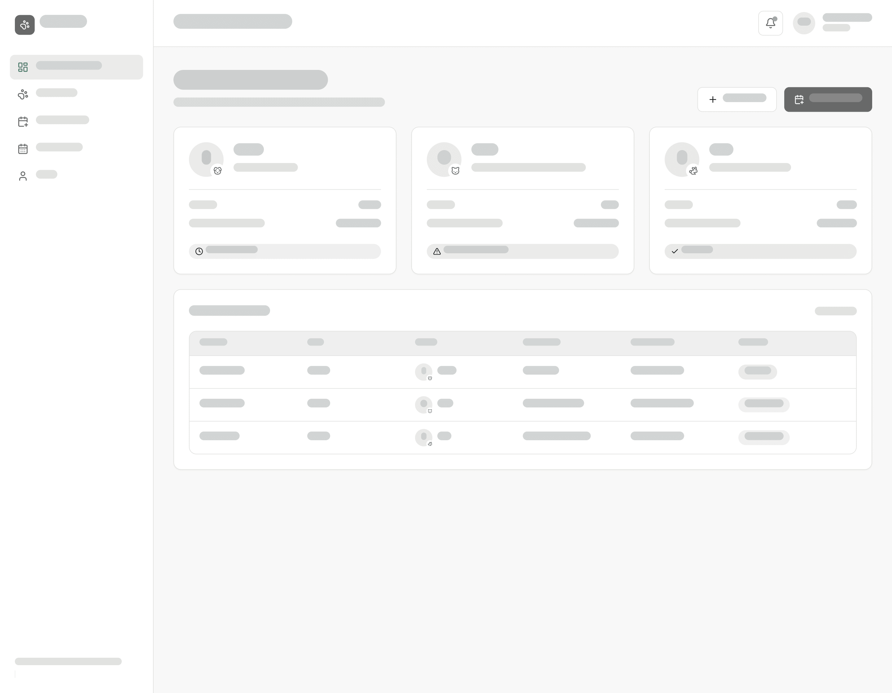
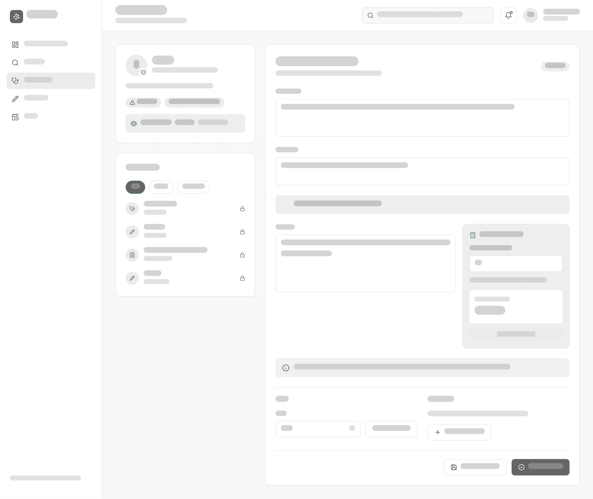
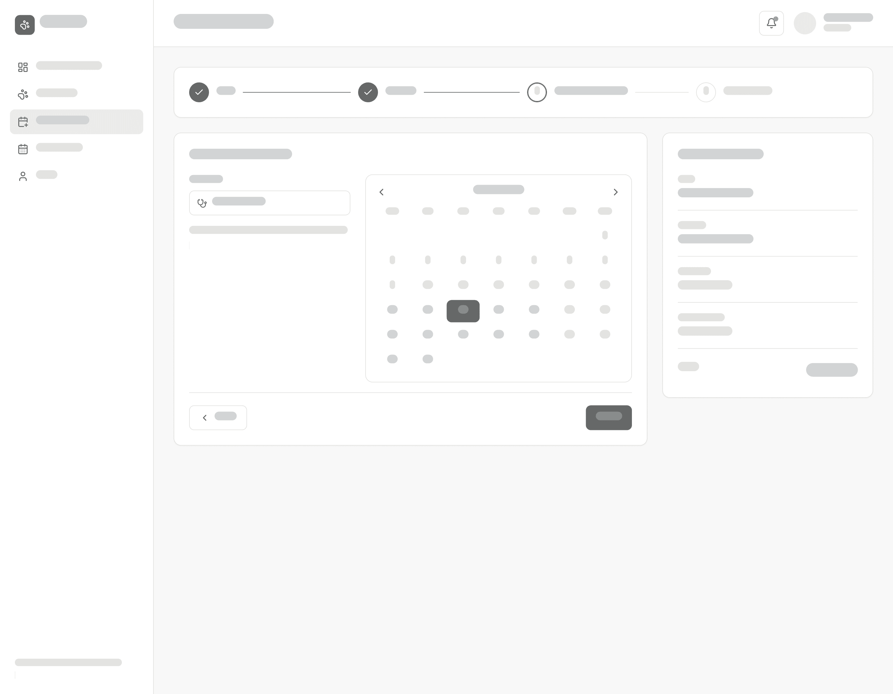

# Wireframes

Wireframe-i prikazujejo osnovno postavitev treh ključnih zaslonov aplikacije Petalog. Izdelani so v Figmi kot nizkoločljivostni (lo-fi) prikaz: besedilo je nadomeščeno s sivimi črtami, barve so odstranjene, ohranjene pa so ikone, ki nakazujejo pomen elementov (npr. ključavnica za zaključen zapis, opozorilni trikotnik za alergije in zapadla cepljenja). Vsi zasloni so namizni.

Vsi zasloni imajo enako ogrodje:
- **levi stranski meni** z logotipom in navigacijo, ki je odvisna od vloge uporabnika (lastnik: *Nadzorna plošča, Moje živali, Naroči termin, Moji termini, Profil*; veterinar: *Nadzorna plošča, Pacienti, Obravnave, Cepljenja, Urnik*),
- **zgornja vrstica** z naslovom strani, ikono za obvestila in imenom ter vlogo prijavljenega uporabnika. Pri veterinarju je v zgornji vrstici še iskalnik pacientov po imenu, lastniku ali številki čipa.

## 1. Lastnik – nadzorna plošča

Začetna stran lastnika po prijavi.
- Pod pozdravom je kratek povzetek (npr. število prihodnjih terminov in zapadlih cepljenj), desno pa gumba **Dodaj žival** in **Naroči termin**.
- Za vsako žival je prikazana **kartica** z avatarjem (začetnica imena in ikona vrste živali), imenom, vrsto in pasmo, starostjo ter datumom naslednjega cepljenja. Oznaka na dnu kartice prikazuje stanje cepljenja z ikono: *kmalu zapade* (ura), *cepljenje zapadlo* (opozorilni trikotnik) ali *veljavno* (kljukica).
- Tabela **Prihodnji termini** prikazuje datum, uro, žival, storitev, veterinarja in status termina (npr. *potrjen*, *rezerviran*), s povezavo na vse termine.

**Povezane uporabniške zgodbe:** US-03 (profil živali), US-04 (stanje cepljenja), US-08 (nadzorna plošča lastnika).

## 2. Veterinar – obravnava pacienta

Osrednji delovni zaslon veterinarja med obravnavo. V zgornji vrstici sta ime živali, ura in storitev termina. Zaslon je razdeljen na dva stolpca:
- **Levi stolpec:**
  - kartica pacienta z imenom, pasmo, spolom, starostjo, lastnikom in telefonom, **alergijami** kot rdečimi oznakami z opozorilno ikono ter zadnjo izmerjeno težo z datumom,
  - **zgodovina** (zdravstvena časovnica) s filtri *Vse / Zapisi / Cepljenja*. Vsak vnos ima ikono vrste, naziv in datum, zaključeni vnosi pa so označeni s ključavnico.
- **Desni stolpec** je obrazec **zdravstvenega zapisa** z oznako statusa *osnutek*:
  - polji **Anamneza** in **Diagnoza**,
  - **opozorilni okvir z alergijami živali** neposredno nad poljem za terapijo,
  - polje **Terapija** in ob njem **kalkulator odmerka**: vnos odmerka v mg/kg, zadnja teža, izračunan skupni odmerek in gumb *Vstavi v terapijo*,
  - informativna vrstica za opozorila (npr. ni zabeleženih alergij, zadnja meritev teže je starejša od 30 dni),
  - razdelek **Teža** z vnosom v kg in gumbom *Shrani meritev* ter razdelek **Cepljenje** z gumbom *Dodaj cepljenje*,
  - na dnu gumba **Shrani osnutek** in **Zaključi zapis**, ki zapis zaklene.

**Povezane uporabniške zgodbe:** US-04 (vnos cepljenja), US-05 (zdravstveni zapis z zaklepanjem), US-06 (časovnica in alergije), US-18 (teža in kalkulator odmerka).

## 3. Lastnik – izbira termina

Tretji korak naročanja termina.
- Na vrhu je **potek naročanja v štirih korakih**: *Žival → Storitev → Veterinar in datum → Prost termin*. Zaključena koraka sta označena s kljukico, trenutni korak je poudarjen.
- Levo je izbira **veterinarja**, pod njo pa razlaga, da so prečrtani dnevi tisti, ko izbrani veterinar ne dela.
- Desno je **mesečni koledar**. Dnevi, ko veterinar ne dela, so prečrtani, pretekli dnevi so zatemnjeni, izbrani dan je poudarjen.
- Na dnu sta gumba **Nazaj** in **Naprej**. Naslednji korak prikaže proste ure izbranega dne.
- Desno je kartica **Povzetek naročila** z izbrano živaljo, storitvijo s trajanjem, veterinarjem, datumom in uro ter ceno storitve. Še neizbrani podatki so označeni z *Še ni izbrano*.

**Povezane uporabniške zgodbe:** US-09 (rezervacija termina), US-12 (delovni čas veterinarjev, ki določa razpoložljive dneve).
